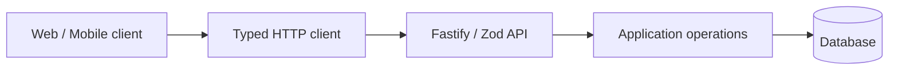

# Planting Platform · Backend

Fastify and TypeScript API supporting a planting-oriented platform, with routes for authentication, plant types, plant records, calendar dates, news, FAQ and uploads.

> **Portfolio disclosure:** Only source-visible capabilities are described here. This is not a claim of production readiness, successful CI, or measurable business impact. Web and mobile clients are separate repositories and are not yet approved for public disclosure.

## Technology

Fastify, TypeScript, Zod, Prisma, WebSocket integrations, object storage adapters

## Architecture snapshot



The diagram is a conceptual integration view across the product family; deployments and connectivity have not been independently verified. See implementation references below for actual repository code.

## Inspect the source

- [`src/routes/authentication-route.ts`](src/routes/authentication-route.ts)
- [`src/routes/plants.ts`](src/routes/plants.ts)
- [`src/routes/plant-type.ts`](src/routes/plant-type.ts)
- [`src/routes/plantation-calendar-date.ts`](src/routes/plantation-calendar-date.ts)
- [`src/routes/upload-route.ts`](src/routes/upload-route.ts)

## Run and validate locally

Install compatible runtimes and dependencies, configure environment values locally (never commit credentials), and run the available scripts:

```bash
yarn install --frozen-lockfile
yarn test
yarn build
```

These are defined project scripts, **not** test results. The test/build environment, external services and credentials require their own setup.

## Engineering topics for technical review

- Module boundaries and validation at HTTP/UI boundaries.
- Typed integration between frontend/mobile and backend where available.
- Authentication, permissions and separation of personal or organizational data.
- Testability, reliability, error handling and dependency management.

## Evidence and security backlog

- [ ] Obtain approval to publicly display project branding and domain-specific information.
- [ ] Complete Git history scan for credentials, private URLs and personal information.
- [ ] Create safe seed/demo data and real anonymized captures of screens or API examples.
- [ ] Verify clean installs and passing quality checks in automated CI.
- [ ] Add architecture decision records and reproducible measurements where supported.

No external deployment or adoption claims are made here.
