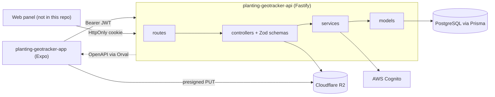
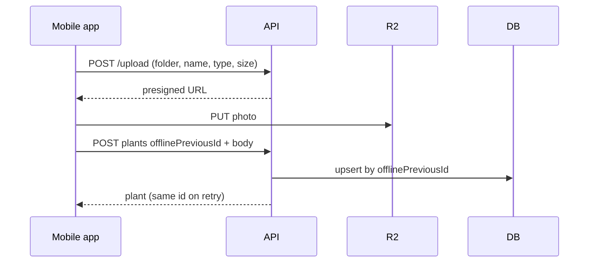

# Planting Geotracker API

REST API that stores geolocated plant records (position, photo, care dates) for a mobile field app and a web panel, with centre-scoped access.

Status: built for a private organisation, with a documented Docker deploy pipeline (`deploy/DEPLOY.md`); not an open product. No load or uptime figures are claimed.

## What it does

- Sign-in against AWS Cognito, then app-issued RS256 JWTs (1 h) as Bearer token or HttpOnly cookie, with refresh (`src/api/v1/services/authentication/`).
- CRUD for plants: name, type, latitude/longitude, address, photo and seven "last done" dates (watering, fertilisation, pest control, pruning, harvest, weeding, soil analysis) (`schema.prisma`, `src/routes/plants.ts`).
- Idempotent create keyed by the client's offline id, so a retried upload never duplicates a plant (`src/api/v1/models/plants-model.ts`).
- Plant types, planting calendar dates, FAQ and news endpoints, all with soft delete.
- Presigned upload URLs to Cloudflare R2, restricted by folder, extension, MIME type and 5 MB (`src/api/v1/controllers/upload/upload.ts`).
- Access gate derived from Cognito claims (grade, roles) or an allow-listed bypass (`src/api/v1/services/authorization/derive-access.ts`).
- OpenAPI served at `/docs` and `/docs/json`, used to generate the mobile client.

## Architecture





- Layers: `routes/` register controllers, `api/v1/controllers` own Zod schemas and HTTP, `services/` hold rules, `models/` are the only code touching Prisma.
- Validation and serialisation run through `fastify-type-provider-zod`; the same schemas generate the OpenAPI document.
- Credentials live in Cognito; the local `User` row is a profile and permission mirror.
- `@fastify/websocket`, puppeteer and ffmpeg are installed but unused by the current routes.

## Data model

`User` (profile, flags, centre) belongs to `Center` (name, region); `Plants` belongs to a `Center` and a `PlantsType` and carries coordinates and care dates; `PlantationCalendarDates`, `Faq` and `News` are standalone content tables. Every table has `isDeleted`/`deletedAt`. Defined in `schema.prisma` (no migrations directory; deploys use `prisma db push`).

## Key engineering decisions

- Offline-safe create: upsert on a unique client id, with a retry when two concurrent resends race on the unique constraint, and no resurrection of server-deleted plants (`src/api/v1/models/plants-model.ts`, `plants-model.test.ts`).
- Dual auth transport: Bearer first, cookie fallback, token `type` claim checked so a refresh token cannot be used as an access token (`src/middlewares/authentication-middleware.ts`, `src/lib/token-type.ts`).
- Validation failures return 400 and Prisma errors are mapped to typed HTTP errors (`src/error-handler.ts`, `src/errors/`).
- Photos go straight from the device to R2 through presigned URLs, so the API never proxies file bytes.
- Cognito as the credential source of truth, with the port described in `docs/superpowers/specs/2026-07-03-cognito-auth-port-design.md`.
- Deployment design (Docker, Cloudflare Tunnel, `prisma db push`) is documented in `deploy/DEPLOY.md`.

## Tech stack

Node 22, TypeScript, Fastify 5, Zod, Prisma 6 on PostgreSQL, AWS Cognito, Cloudflare R2 (S3 SDK), Swagger UI, Vitest, tsup, Biome, Docker.

## Getting started

Prerequisites: Node 22, Yarn, PostgreSQL, a Cognito user pool, an R2 bucket.

```bash
yarn install --frozen-lockfile
cp .env-example .env          # fill in your own values
npx prisma generate
npx prisma db push            # creates tables from schema.prisma
yarn dev                      # http://localhost:$PORT, docs at /docs
```

| Variable | Purpose |
| --- | --- |
| `PORT`, `ENVIRONMENT` | Listen port; `development` or `production` |
| `DATABASE_URL` | PostgreSQL connection string |
| `JWT_PRIVATE_KEY`, `JWT_PUBLIC_KEY` | Base64 RS256 key pair for app tokens |
| `AWS_BUCKET_NAME`, `AWS_ACCOUNT_ID`, `AWS_ACCESS_KEY_ID`, `AWS_SECRET_ACCESS_KEY`, `AWS_PUBLIC_SUBDOMAIN` | R2 storage and public URL |
| `COGNITO_REGION`, `COGNITO_USER_POOL_ID`, `COGNITO_USER_POOL_CLIENT_ID` | Cognito pool |
| `BYPASS_EMAILS` | Comma-separated emails that skip the access rule |
| `MOCK_*` | Development-only claim mocks for allow-listed emails |

The production CORS origin is hard-coded in `src/app.ts`; change it for your own deployment.

## Testing

7 Vitest tests in 3 files (error handler, token type, plant create idempotency); `yarn test`. `yarn build` (tsup) succeeds locally. No integration tests against a real database.

## Project structure

```text
src/routes/            route registration
src/api/v1/            controllers, services, models, constants
src/middlewares/       authentication hook
src/lib/               Prisma, R2 client, token helpers
schema.prisma          data model
deploy/, docs/         deployment notes, design specs
```

## Related repositories

- [planting-geotracker-app](https://github.com/mkwitko/planting-geotracker-app): Expo mobile client.

## License

All rights reserved. Source available for portfolio review.
